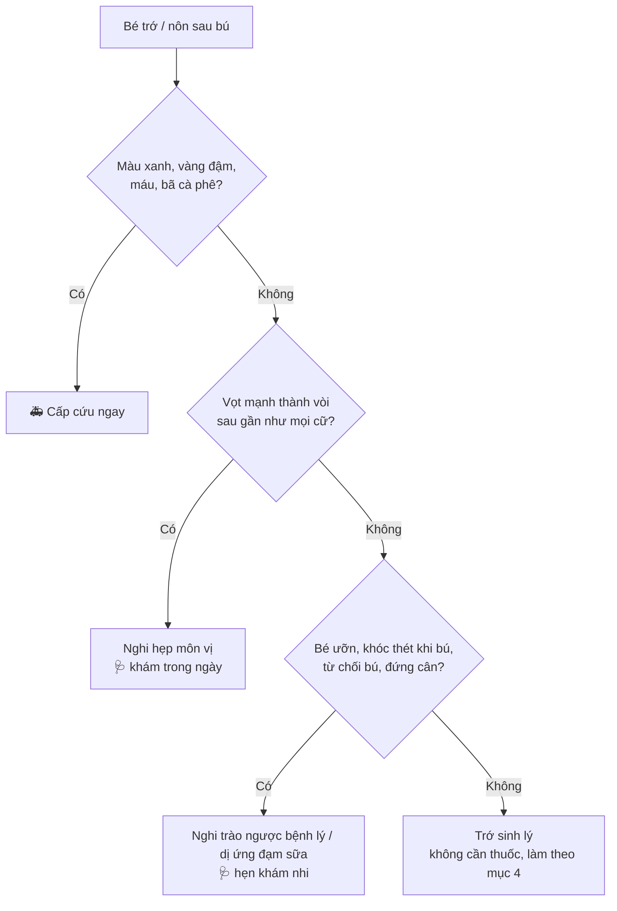

# Trớ sữa & nôn sau bú — 0 đến 6 tháng

> **Tóm lại:** bé trớ, kể cả trớ ra cục vón chua sau vài chục phút, là **bình thường** nếu bé vẫn vui, đủ tã và lên cân. Màu và độ vọt mới là thứ cần nhìn, không phải lượng hay cục.

---

## 1. Vì sao bé sơ sinh hay trớ

- **Van giữa thực quản và dạ dày còn lỏng.** Dạ dày đầy hoặc bé gập bụng là sữa trào ngược lên. Van chặt dần khi bé lớn, ngồi được, ăn đặc hơn.
- **Dạ dày rất nhỏ:** ngày 1 chỉ cỡ 5–7 ml (hạt anh đào), ngày 3 khoảng 25 ml, tuần 1 khoảng 45–60 ml, tháng 1 khoảng 80–150 ml. Bú quá một chút là tràn.
- **Nuốt hơi** khi bú (ngậm ti nông, bú vội, bình nghiêng sai, khóc lâu rồi mới bú). Bóng hơi đi lên kéo theo sữa.
- **Sữa xuống mạnh** (mẹ nhiều sữa) hoặc núm bình chảy nhanh → bé nuốt nhiều hơn dạ dày chứa.

Khoảng một nửa bé dưới 3 tháng trớ mỗi ngày. Tăng dần, nhiều nhất quanh **4 tháng**, giảm rõ khi bé **ngồi vững (6–7 tháng)**, đa số hết trước **12 tháng**.

---

## 2. Đọc chất trớ: lúc nào, trông ra sao

| Kiểu trớ | Trông thế nào | Vì sao | Có sao không |
|---|---|---|---|
| **Trớ ngay** (trong lúc bú hoặc vài phút sau) | Trắng, loãng, giống sữa vừa bú, không mùi chua | Sữa chưa kịp xuống sâu, trào ra cùng bóng hơi khi ợ hoặc khi đặt bé nằm | Bình thường |
| **Trớ vón cục sau 20–90 phút** | Cục trắng/ngà như sữa chua, đậu hũ non hoặc phô mai, lẫn nước trong, **mùi chua** | Sữa đã gặp axit và men dạ dày nên **đông lại** — đó là bước đầu của tiêu hóa, không phải "sữa không tiêu" | Bình thường |
| Sữa công thức vón | Cục to, chắc, chua hơn sữa mẹ | Đạm sữa bò đông cục to hơn đạm sữa mẹ | Bình thường |
| Trớ ra mũi | Sữa chảy ra một hoặc hai lỗ mũi, bé hắt hơi | Mũi và họng thông nhau | Bình thường — lau, để bé hắt hơi, nhỏ nước muối nếu nghẹt |
| **Ngày 1–2 sau sinh** | Dịch nhầy trong hoặc hơi nâu, có thể lẫn vệt máu | Nước ối, nhầy, máu mẹ bé nuốt lúc sinh | Bình thường nếu hết sau 48h và bé bú được |
| Hơi vàng nhạt ngày 2–5 | Màu sữa non | Sữa non vốn vàng | Bình thường |
| **Có vệt đỏ / nâu sau ngày 2** | Vệt máu, chấm nâu | Hay gặp nhất: **đầu ti mẹ nứt**, bé nuốt máu mẹ | Xem ti mẹ trước. Ti lành → **đi khám trong ngày** |
| **Xanh lá / xanh rêu / vàng đậm như mật** | Dịch mật | Có thể tắc ruột, xoắn ruột | 🚑 **Cấp cứu ngay**, bất kể giờ nào |
| **Nâu đen như bã cà phê**, hoặc máu đỏ nhiều | Máu đã qua dạ dày | Chảy máu đường tiêu hoá | 🚑 **Cấp cứu ngay** |

**Mẹo đo lượng:** đổ **1 thìa canh (15 ml)** sữa lên khăn xô — vết loang trông như "trớ hết cả cữ". Phần lớn các lần trớ chỉ 5–15 ml. Bé trớ xong vẫn giữ phần lớn sữa.

---

## 3. Trớ, nôn hay bệnh — nhìn vào bé, không nhìn vào khăn

Ba nhóm cần biết thêm:

### Trớ sinh lý ("happy spitter")
Bé trớ nhiều nhưng **vẫn vui, bú tốt, ≥6 tã ướt/ngày, lên cân đều** → không phải bệnh, không cần thuốc, không cần đổi sữa. Đây là đa số.

### Hẹp môn vị (cơ đáy dạ dày dày lên, sữa không xuống ruột được)
- Thường bắt đầu **tuần 2–8**.
- Nôn **vọt mạnh** (bắn xa cả gang tay trở lên), sau **gần như mọi cữ**, tăng dần theo ngày.
- Nôn xong **bé đói, đòi bú lại ngay** — khác bé ốm thường bỏ bú.
- Ít tã ướt, sụt cân hoặc đứng cân.
- → **Khám trong ngày.** Chữa bằng mổ nhỏ, kết quả rất tốt nếu phát hiện sớm.

### Trào ngược bệnh lý (GERD) hoặc dị ứng đạm sữa bò
Nghĩ đến khi trớ đi kèm **một trong các dấu hiệu**:
- Ưỡn cong lưng, khóc thét **trong lúc bú**, từ chối bú dù đói
- Không lên cân / sụt cân
- Ho, khò khè, thở rít kéo dài; viêm phổi tái lại
- Trớ **bắt đầu sau 6 tháng**, hoặc còn nhiều sau 12–18 tháng
- (Dị ứng đạm sữa) kèm chàm da, phân nhầy hoặc có vệt máu, quấy nhiều

→ Hẹn khám nhi. **Không tự mua thuốc chống trào ngược, không tự đổi sang sữa thủy phân / sữa đặc chế**, không tự kiêng sữa bò ở mẹ — để bác sĩ quyết.

---

## 4. Giảm trớ — làm gì trong và sau cữ bú

**Trong cữ**
- Cho bú khi bé **mới có dấu hiệu đói sớm** (mút tay, quay đầu tìm ti), đừng đợi khóc to — khóc là nuốt hơi.
- **Ngậm ti sâu**. Sữa xuống ồ ạt thì vắt bớt 1–2 phút đầu, cho bú tư thế mẹ ngả lưng.
- Bú bình: **bế bé gần thẳng, bình nằm ngang** (paced feeding), núm đúng cỡ — lật ngược bình, sữa nhỏ giọt chứ không chảy thành dòng.
- **Cữ nhỏ hơn, gần hơn** thay vì cữ to. Không ép bú hết bình — bé nhả ti, quay đi là no.
- **Ợ hơi giữa cữ:** lúc đổi bên (bú mẹ) hoặc sau mỗi 30–60 ml (bú bình), và cuối cữ. Vỗ nhẹ hoặc xoa lưng; bế dựng trên vai hoặc ngồi trên đùi đỡ cằm. 1–2 phút chưa ợ thì thôi, không cần vỗ mãi.

**Sau cữ**
- **Bế thẳng 15–20 phút** (bé trớ nhiều: tới 30 phút). Áp ngực người lớn là đủ.
- Không lắc, không tung, không đè bụng, không tummy time, không mặc tã/quần **bó bụng** ngay sau bú.
- Thay tã **trước** cữ bú thay vì sau (gập chân lên bụng lúc thay tã dễ trớ).
- Không đặt bé ngồi gập người trên ghế rung, nôi ô tô ngay sau bú — gập bụng làm trớ nhiều hơn, không ít hơn.

**Lúc bé trớ**
- Bé nằm ngửa mà trớ: **nghiêng đầu bé sang một bên**, lau miệng mũi. Bé có phản xạ tự bảo vệ đường thở, ho được, khóc được là ổn.
- Bé ho sặc, tím môi, im bặt → gọi cấp cứu 115 và sơ cứu sặc (vỗ lưng, ấn ngực) ngay.
- **Có cho bú lại không?** Bé đòi thì cho bú lại, cữ ngắn. Bé không đòi thì đợi cữ sau — không cần "bù" cho đủ.
- Lau nếp cổ sau mỗi lần trớ, sữa đọng ở cổ rất nhanh hăm.

**Lúc ngủ**
- **Luôn đặt nằm ngửa, mặt phẳng cứng, không gối.** Bé nằm ngửa **không dễ sặc chất trớ hơn** bé nằm nghiêng/sấp — nằm sấp/nghiêng mới làm tăng nguy cơ đột tử.
- **Không kê cao đầu cũi**, không dùng gối chống trào ngược, gối chặn, đệm nghiêng — bé tuột xuống, gập cổ, nguy hiểm hơn trớ.

---

## 5. Những điều hay nghe nhưng sai

| Hay nghe | Thực tế |
|---|---|
| "Trớ vón cục là bé không tiêu, sữa mẹ đặc / nóng" | Vón cục là sữa **đã bắt đầu tiêu** trong dạ dày. Không liên quan chất lượng sữa mẹ. |
| "Trớ nhiều là mất cữ, phải cho bú bù ngay cho đầy" | Bé giữ được phần lớn sữa. Ép thêm vào dạ dày đang đầy → trớ tiếp. |
| "Cho uống tí nước cho sạch miệng / đỡ trớ" | **Không cho uống nước trước 6 tháng** — kể cả nước lọc, nước đường, nước lá. |
| "Pha sữa đặc hơn, thêm bột gạo cho bé đỡ trớ" | Không tự làm. Pha sai tỷ lệ hại thận, đường ruột; làm đặc chỉ khi bác sĩ chỉ định. |
| "Cho bé ngủ nghiêng / sấp / kê gối cao cho khỏi sặc" | Tăng nguy cơ đột tử. Ngửa, phẳng, không gối. |
| "Trớ nhiều thì đổi sữa khác" | Đổi sữa liên tục không giảm trớ sinh lý, chỉ làm bé rối bụng. Chỉ đổi khi bác sĩ nghi dị ứng. |
| "Vỗ lưng thật mạnh cho ợ" | Vỗ nhẹ, xoa lưng là đủ. Không ợ cũng không sao. |

---

## 6. Ghi gì để đưa bác sĩ xem

- Số lần trớ/nôn trong ngày, **trớ ngay hay sau bao lâu**, lượng ước (thìa cà phê / thìa canh / gần cả cữ).
- **Chụp ảnh chất trớ** trên khăn (thấy màu) và **quay video** một lần nôn nếu nghi vọt.
- Số tã ướt, phân (màu, có nhầy/máu không), cân nặng gần nhất.
- Bé có ưỡn, khóc khi bú, từ chối bú, ho khò khè không.
